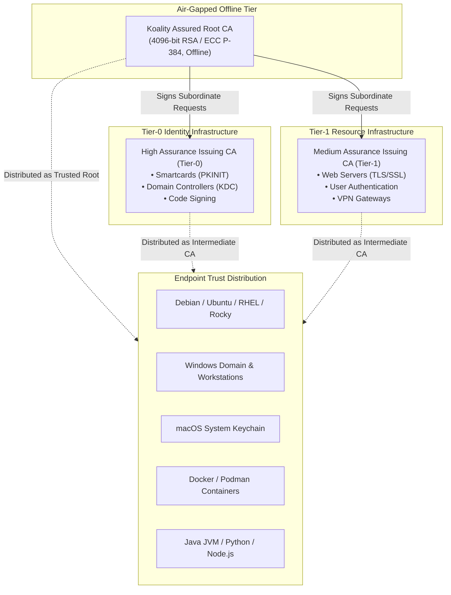

# Cross-Platform Enterprise PKI Trust Distribution Guide

This guide provides operational guidance and automated commands for distributing and installing internal Root and Intermediate Certification Authority (CA) certificates across heterogeneous operating systems, runtimes, and container platforms.

---

## Architecture Overview

Enterprise PKI operates under a hierarchical trust chain where endpoint devices establish trust in issued certificates by validating a signature path back to an internal **Root Certification Authority**.



---

## Prerequisites and Endpoints

Before executing distribution scripts, verify access to the high-availability HTTP CRL and AIA distribution endpoints:

- **Root CA Certificate (`.crt` / `.pem`):** `http://pki.corp.example.com/pki/RootCA.crt`
- **Subordinate CA Certificates:** `http://pki.corp.example.com/pki/HighICA01.crt`, `http://pki.corp.example.com/pki/MedICA01.crt`
- **Certificate Revocation Lists (`.crl`):** `http://pki.corp.example.com/pki/RootCA.crl`

---

## 1. Debian / Ubuntu / Linux Mint

Debian-based distributions store trusted CA certificates in `/usr/local/share/ca-certificates/` in `.crt` format (PEM-encoded).

### Automated Shell Script

```bash
#!/usr/bin/env bash
set -euo pipefail

echo "[*] Installing internal PKI certificates on Debian/Ubuntu..."

# 1. Install prerequisites
sudo apt-get update -qq
sudo apt-get install -y ca-certificates curl

# 2. Download Root and Intermediate CA certificates
TARGET_DIR="/usr/local/share/ca-certificates/enterprise"
sudo mkdir -p "${TARGET_DIR}"

sudo curl -sSL -o "${TARGET_DIR}/koality-root-ca.crt" \
    "http://pki.corp.example.com/pki/RootCA.crt"
sudo curl -sSL -o "${TARGET_DIR}/koality-high-ica.crt" \
    "http://pki.corp.example.com/pki/HighICA01.crt"
sudo curl -sSL -o "${TARGET_DIR}/koality-med-ica.crt" \
    "http://pki.corp.example.com/pki/MedICA01.crt"

# 3. Ensure permissions
sudo chmod 644 "${TARGET_DIR}"/*.crt

# 4. Rebuild the system certificate bundle (/etc/ssl/certs/ca-certificates.crt)
sudo update-ca-certificates --fresh

echo "[OK] Debian/Ubuntu certificate trust store updated successfully."
```

---

## 2. RHEL / Rocky Linux / AlmaLinux / CentOS / Fedora

Red Hat Enterprise Linux derivatives utilize dynamic CA trust configuration (`update-ca-trust`) reading from `/etc/pki/ca-trust/source/anchors/`.

### Automated Shell Script

```bash
#!/usr/bin/env bash
set -euo pipefail

echo "[*] Installing internal PKI certificates on RHEL / Rocky Linux..."

# 1. Install ca-certificates package
sudo dnf install -y ca-certificates curl

# 2. Enable dynamic CA trust extraction
sudo update-ca-trust force-enable

# 3. Download CA certificates into the trust anchors directory
ANCHORS_DIR="/etc/pki/ca-trust/source/anchors"

sudo curl -sSL -o "${ANCHORS_DIR}/koality-root-ca.pem" \
    "http://pki.corp.example.com/pki/RootCA.crt"
sudo curl -sSL -o "${ANCHORS_DIR}/koality-high-ica.pem" \
    "http://pki.corp.example.com/pki/HighICA01.crt"
sudo curl -sSL -o "${ANCHORS_DIR}/koality-med-ica.pem" \
    "http://pki.corp.example.com/pki/MedICA01.crt"

# 4. Set standard permissions
sudo chmod 644 "${ANCHORS_DIR}"/koality-*.pem

# 5. Extract and update the bundle (/etc/pki/tls/certs/ca-bundle.crt)
sudo update-ca-trust extract

echo "[OK] RHEL / Rocky Linux CA trust updated successfully."
```

---

## 3. macOS (System Keychain)

macOS stores root and intermediate certificates in the system keychain (`/Library/Keychains/System.keychain`) managed via the `security` CLI.

### Automated macOS Script

```bash
#!/usr/bin/env bash
set -euo pipefail

echo "[*] Installing internal PKI certificates on macOS System Keychain..."

TMP_DIR="$(mktemp -d)"
trap 'rm -rf "${TMP_DIR}"' EXIT

# 1. Download certificates
curl -sSL -o "${TMP_DIR}/RootCA.crt" "http://pki.corp.example.com/pki/RootCA.crt"
curl -sSL -o "${TMP_DIR}/HighICA01.crt" "http://pki.corp.example.com/pki/HighICA01.crt"
curl -sSL -o "${TMP_DIR}/MedICA01.crt" "http://pki.corp.example.com/pki/MedICA01.crt"

# 2. Install Root CA as a trusted root (-d: admin trust, -r trustRoot)
sudo security add-trusted-cert \
    -d \
    -r trustRoot \
    -k /Library/Keychains/System.keychain \
    "${TMP_DIR}/RootCA.crt"

# 3. Install Intermediate CAs (-r trustAsRoot)
sudo security add-trusted-cert \
    -d \
    -r trustAsRoot \
    -k /Library/Keychains/System.keychain \
    "${TMP_DIR}/HighICA01.crt"

sudo security add-trusted-cert \
    -d \
    -r trustAsRoot \
    -k /Library/Keychains/System.keychain \
    "${TMP_DIR}/MedICA01.crt"

echo "[OK] macOS System Keychain trust established."
```

---

## 4. Microsoft Windows

### Method A: Active Directory Group Policy (Enterprise Domain-Joined)

In an Active Directory domain, internal root and intermediate certificates should be published into Active Directory directory partitions for automated replication across all domain-joined workstations and servers:

```powershell
# Run from an administrative domain workstation as PKI-Admin / Enterprise Admin:

# 1. Publish Root CA to Active Directory Trusted Root Certification Authorities container:
certutil -dspublish -f "C:\PKI\RootCA.crt" RootCA

# 2. Publish Subordinate CAs to the SubCA container:
certutil -dspublish -f "C:\PKI\HighICA01.crt" SubCA
certutil -dspublish -f "C:\PKI\MedICA01.crt" SubCA

# 3. Force GPO refresh on client endpoints:
gpupdate /force
```

### Method B: Standalone / Non-Domain Windows PowerShell

For non-domain Windows workstations, cloud VMs, or CI/CD runners:

```powershell
# Execute in an elevated PowerShell session (Run as Administrator):

$pkiUrl = "http://pki.corp.example.com/pki"
$tempPath = "$env:TEMP\PKITrust"
New-Item -ItemType Directory -Path $tempPath -Force | Out-Null

try {
    # 1. Download Certificates
    Invoke-WebRequest -Uri "$pkiUrl/RootCA.crt" -OutFile "$tempPath\RootCA.crt"
    Invoke-WebRequest -Uri "$pkiUrl/HighICA01.crt" -OutFile "$tempPath\HighICA01.crt"
    Invoke-WebRequest -Uri "$pkiUrl/MedICA01.crt" -OutFile "$tempPath\MedICA01.crt"

    # 2. Import Root CA into LocalMachine\Root (Trusted Root Certification Authorities)
    Import-Certificate -FilePath "$tempPath\RootCA.crt" -CertStoreLocation 'Cert:\LocalMachine\Root' | Out-Null
    Write-Host "[+] Imported Root CA into LocalMachine\Root" -ForegroundColor Green

    # 3. Import Intermediate CAs into LocalMachine\CA (Intermediate Certification Authorities)
    Import-Certificate -FilePath "$tempPath\HighICA01.crt" -CertStoreLocation 'Cert:\LocalMachine\CA' | Out-Null
    Import-Certificate -FilePath "$tempPath\MedICA01.crt" -CertStoreLocation 'Cert:\LocalMachine\CA' | Out-Null
    Write-Host "[+] Imported Subordinate CAs into LocalMachine\CA" -ForegroundColor Green
} finally {
    Remove-Item -Path $tempPath -Recurse -Force -ErrorAction SilentlyContinue
}
```

---

## 5. Container Platforms (Docker / Podman)

To embed internal PKI trust inside base container images:

```dockerfile
# Debian / Ubuntu Base
FROM ubuntu:24.04

RUN apt-get update && apt-get install -y ca-certificates curl && rm -rf /var/lib/apt/lists/*
ADD http://pki.corp.example.com/pki/RootCA.crt /usr/local/share/ca-certificates/RootCA.crt
ADD http://pki.corp.example.com/pki/HighICA01.crt /usr/local/share/ca-certificates/HighICA01.crt
RUN chmod 644 /usr/local/share/ca-certificates/*.crt && update-ca-certificates
```

```dockerfile
# Alpine Linux Base
FROM alpine:3.20

RUN apk add --no-cache ca-certificates curl
ADD http://pki.corp.example.com/pki/RootCA.crt /usr/local/share/ca-certificates/RootCA.crt
RUN chmod 644 /usr/local/share/ca-certificates/RootCA.crt && update-ca-certificates
```

---

## 6. Language Runtimes & Keystores

### Java JVM Keystore (`cacerts`)

Java applications rely on their own internal trust store located at `$JAVA_HOME/lib/security/cacerts`:

```bash
# Locate cacerts
KEYSTORE="${JAVA_HOME}/lib/security/cacerts"

# Import Root CA (default Java keystore password is 'changeit')
sudo keytool -importcert \
    -noprompt \
    -trustcacerts \
    -alias "koality-root-ca" \
    -file "/usr/local/share/ca-certificates/enterprise/koality-root-ca.crt" \
    -keystore "${KEYSTORE}" \
    -storepass changeit
```

### Python (`requests`, `httpx`, `urllib3`)

Python environments using `certifi` can be directed to the system or internal bundle via environment variables:

```bash
# Point Python to system certificate bundle:
export SSL_CERT_FILE="/etc/ssl/certs/ca-certificates.crt"    # Debian/Ubuntu
export REQUESTS_CA_BUNDLE="/etc/pki/tls/certs/ca-bundle.crt" # RHEL/Rocky
```

---

## 7. Verification and Troubleshooting

### OpenSSL Verification

Verify certificate chain resolution against the Root CA:

```bash
# Download and verify an issued server certificate
openssl verify -CAfile /etc/ssl/certs/ca-certificates.crt server-cert.crt
```

### Curl Test

```bash
curl -Iv https://web01.corp.example.com/
# Expected: SSL certificate verify ok. (HTTP status 200)
```

### PowerShell Verification

```powershell
$cert = Get-ChildItem -Path Cert:\LocalMachine\Root | Where-Object { $_.Subject -match 'Koality Assured Root CA' }
if ($cert) {
    Write-Host "[OK] Root CA installed: $($cert.Subject) [Expires: $($cert.NotAfter)]" -ForegroundColor Green
} else {
    Write-Error "Root CA not found in LocalMachine\Root store."
}
```
