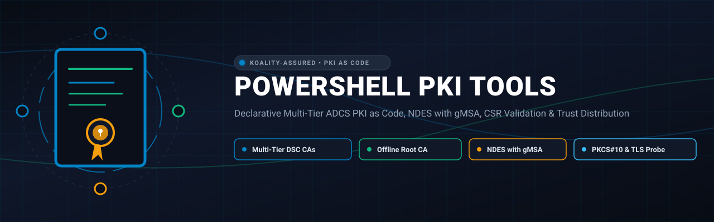
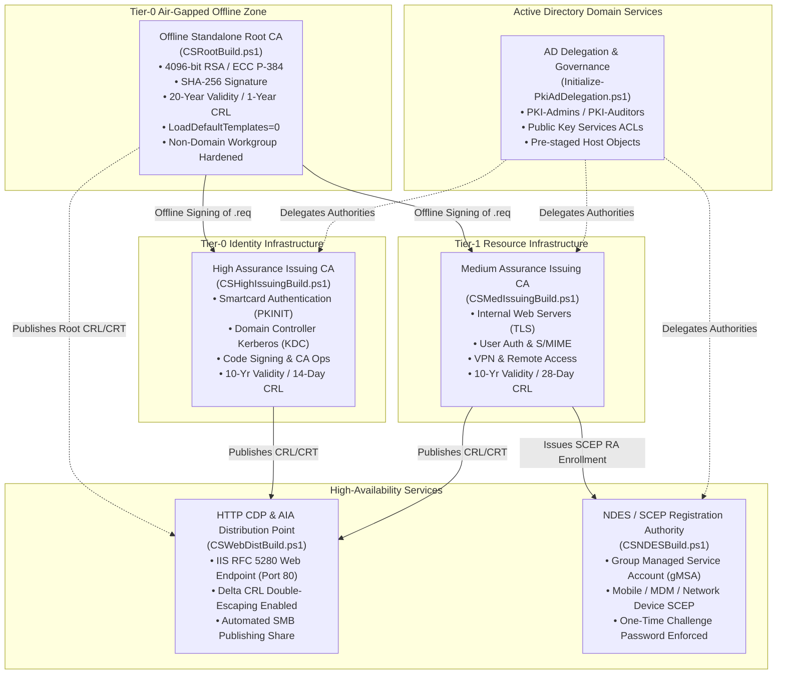

<div align="center">



# PowerShell PKI Tools

<p align="center">
  
</p>

**Declarative Multi-Tier ADCS PKI as Code, NDES with gMSA, CSR Validation & Trust Distribution**

[](https://github.com/Koality-Assured/PowerShell-PKI-Tools/actions/workflows/ci.yml)
[](LICENSE)
[](https://github.com/PowerShell/PowerShell)
[]()
[](https://conventionalcommits.org)

</div>

---

## Architecture: Multi-Tier PKI Trust Hierarchy



---

## Repository Structure

```
PowerShell-PKI-Tools/
├── DSC/                                      # Declarative Desired State Configuration scripts
│   ├── CSRootBuild.ps1                       # Offline Standalone Root CA build & CAPolicy generator
│   ├── CSHighIssuingBuild.ps1                # Tier-0 Enterprise Subordinate CA (Smartcard/DC/CodeSign)
│   ├── CSMedIssuingBuild.ps1                 # Tier-1 Enterprise Subordinate CA (Web TLS/User Auth/VPN)
│   ├── CSWebDistBuild.ps1                    # IIS HTTP CDP/AIA Web Endpoint & SMB Publishing
│   └── CSNDESBuild.ps1                       # SCEP / NDES Service with Group Managed Service Account
├── ActiveDirectory/                          # Active Directory Directory Services automation
│   └── Initialize-PkiAdDelegation.ps1        # Security groups, OUs, and Public Key Services ACLs
├── Validation/                               # Cryptographic & endpoint validation utilities
│   ├── Test-CsrRequest.ps1                   # PKCS#10 CSR parser, signature validator & policy engine
│   └── Test-TlsCipherSupport.ps1             # TLS 1.2/1.3 protocol scanner & cert chain inspector
├── Documentation/                            # Architecture standards & deployment guides
│   └── Trust-Distribution-Guide.md           # Cross-platform root trust installation guide
├── tests/                                    # Automated Pester and Python verification suites
│   ├── fixtures/                             # Synthetically generated public CSR test fixtures
│   ├── Validation.Tests.ps1                  # Pester unit tests for validation utilities
│   ├── DscConfigurations.Tests.ps1           # Pester tests for DSC scripts & security assertions
│   ├── PkiTools.Tests.ps1                    # Pester integration tests for AD delegation
│   └── test_pki_framework.py                 # Python test suite verifying syntax & zero-leak status
├── .github/workflows/ci.yml                  # GitHub Actions CI pipeline running full audits
├── adversarial_review.py                     # Antagonistic zero-leak security audit script
├── SECURITY.md                               # Cryptographic security & vulnerability disclosure policy
├── CONTRIBUTING.md                           # Development guidelines & contribution checklist
├── AGENTS.md                                 # Canonical rules and directives for AI agents
├── LICENSE                                   # Apache-2.0 License
└── README.md                                 # Project documentation and quickstart
```

---

## Key Features & Security Innovations

### 1. Standalone Non-Domain Credential Fix
In upstream Microsoft `xActiveDirectoryCSDsc`, the `Credential` parameter in `MSFT_AdcsCertificationAuthority.schema.mof` is marked as `[Required]`. In an offline workgroup Root CA, passing domain credentials is fundamentally impossible. `CSRootBuild.ps1` implements the standalone fix by handling `Credential` as an optional parameter (`[write]`), allowing offline workgroup deployment to proceed cleanly under local administrator authority.

### 2. Delta CRL Double Escaping Protection
Delta CRL file names generated by AD CS contain a `+` symbol (e.g. `RootCA+Base.crl`). By default, IIS Request Filtering rejects requests with `+` characters (HTTP 404.11). `CSWebDistBuild.ps1` automatically configures `system.webServer/security/requestFiltering/allowDoubleEscaping = true` and registers proper MIME types (`application/pkix-crl` and `application/x-x509-ca-cert`).

### 3. Group Managed Service Account (gMSA) for NDES
Traditional NDES deployments require static service account passwords that expire and present Kerberoasting vulnerabilities. `CSNDESBuild.ps1` deploys NDES leveraging modern Active Directory gMSAs, managing password rotation and Kerberos Service Principal Names automatically.

### 4. Comprehensive PKCS#10 CSR Policy Validation
`Validation/Test-CsrRequest.ps1` verifies:
- Cryptographic proof-of-possession signature verification (detects request corruption or key mismatch).
- Public key size enforcement (RSA >= 2048/4096-bit, ECC >= P-256/P-384).
- Hash algorithm validation (rejects deprecated MD5 and SHA-1).
- Subject Alternative Name (SAN) extraction and wildcard policy enforcement.

---

## Quickstart Deployment Guide

### Step 1: Active Directory Infrastructure Preparation
Run from an elevated PowerShell prompt on a domain management machine:

```powershell
.\ActiveDirectory\Initialize-PkiAdDelegation.ps1 -DomainName 'corp.example.com' -WhatIf
.\ActiveDirectory\Initialize-PkiAdDelegation.ps1 -DomainName 'corp.example.com'
```

### Step 2: Build the Offline Standalone Root CA
On an isolated, air-gapped server running Windows Server:

```powershell
.\DSC\CSRootBuild.ps1 `
    -CACommonName 'Koality Assured Root CA' `
    -KeyAlgorithm 'RSA' `
    -KeyLength 4096 `
    -ValidityPeriodUnits 20 `
    -CRLPeriodUnits 1
```

### Step 3: Deploy the High-Availability Web Distribution Server
On the internal IIS CDP/AIA server:

```powershell
.\DSC\CSWebDistBuild.ps1 `
    -DistHostname 'WEBDIST01' `
    -DomainName 'corp.example.com' `
    -PkiDistPath 'C:\PKI\Distribution'
```

### Step 4: Build Enterprise Subordinate Issuing CAs
On Tier-0 and Tier-1 issuing servers:

```powershell
# Tier-0 (Smartcards, DCs, Code Signing)
.\DSC\CSHighIssuingBuild.ps1 `
    -CACommonName 'Koality Assured High Assurance Issuing CA' `
    -DomainName 'corp.example.com'

# Tier-1 (Internal Web TLS, User Certificates, VPN)
.\DSC\CSMedIssuingBuild.ps1 `
    -CACommonName 'Koality Assured Medium Assurance Issuing CA' `
    -DomainName 'corp.example.com'
```

Submit the generated `.req` files from each issuing CA to the offline Root CA for signing (`certreq -submit`).

### Step 5: Deploy NDES / SCEP for Network Appliances & Mobile
On the registration authority server:

```powershell
.\DSC\CSNDESBuild.ps1 `
    -NdesHostname 'NDES01' `
    -DomainName 'corp.example.com' `
    -NdesGmsaName 'gmsa-pki-ndes$'
```

---

## Validation & Testing

### Validate a Certificate Request (.req)

```powershell
.\Validation\Test-CsrRequest.ps1 -Path '.\tests\fixtures\valid_rsa2048.req' -RequireSan
```

### Probe Remote TLS Endpoints

```powershell
.\Validation\Test-TlsCipherSupport.ps1 -ComputerName 'pki.corp.example.com' -Port 443
```

### Run Full Test Suite

```powershell
# Execute PowerShell Pester Tests (42 assertions)
Invoke-Pester -Path tests

# Execute Python Test Suite
python -m unittest tests/test_pki_framework.py -v
```

---

## Antagonistic Security Audit

Run the standalone Koality Assured security audit script:

```bash
python adversarial_review.py
```

Output:
```
==============================================================================
[KOALITY ASSURED AUDIT] AUDIT SUMMARY REPORT
==============================================================================
Stage Name                   | Status     | Violations
-----------------------------+------------+-----------
Sanitization Check           | PASSED     | 0         
Secret & Key Audit           | PASSED     | 0         
Hash Inventory               | PASSED     | 0         
PowerShell AST Syntax        | PASSED     | 0         
Test Suite Execution         | PASSED     | 0         

[VERDICT: APPROVED] 0 violations detected. Repository meets Koality Assured Security Standard.
```

---

## Cross-Platform Trust Distribution

For instructions on deploying the Root CA certificate to Linux (Debian, Ubuntu, RHEL, Rocky), macOS Keychains, Docker containers, Java JVM cacerts, and Python environments, consult:

:book: **[Trust-Distribution-Guide.md](Documentation/Trust-Distribution-Guide.md)**

---

## License

This project is licensed under the **Apache License, Version 2.0**. See the [LICENSE](LICENSE) file for details.